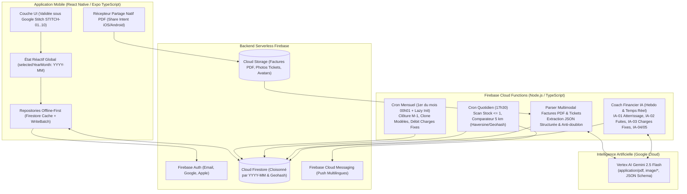
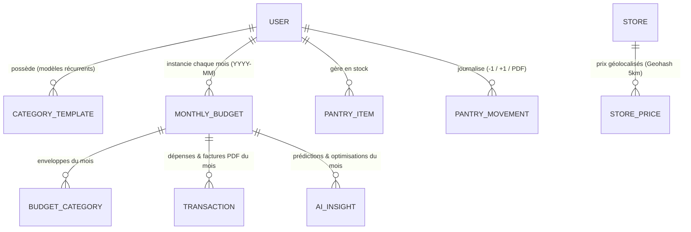

# Architecture Technique & Spécifications Système — EcoPanier & Budget IA

**Version :** 3.1.0  
**Architecture :** Monorepo TypeScript Full-Stack Serverless (Firebase BaaS + Vertex AI Gemini 2.5 Flash + React Native / Expo)  
**Projet Google Stitch :** `projects/3524352228818451830` (`assets/4437186412263531233`)

---

## 1. Vue d'Ensemble de l'Architecture

L'application **EcoPanier & Budget IA** relie de façon transactionnelle trois domaines traditionnellement silotés :
1. **Le Budget Mensuel Cloisonné (`YYYY-MM`)** avec reconduction automatique le 1er du mois ("Zéro Ressaisie") et calcul du Reste à vivre réel.
2. **La Réserve Domestique ("1-Tap Use")** avec suivi des mouvements horodatés (`-1` / `+1`), alertes dès `Quantité <= 1` et prédiction de rupture par IA (`Smart Depletion`).
3. **Le Comparateur Géolocalisé (Rayon 5 km) & Acquisition IA Multimodale** (Import direct de factures PDF Drive/e-tickets, scan EAN-13 et photo ticket OCR via Gemini 2.5 Flash).



---

## 2. Organisation du Monorepo (`d:\Projets\Depense`)

Le projet est structuré en **Monorepo TypeScript (NPM Workspaces)** afin de garantir un partage strict des types, schémas de validation et formules métier entre les Cloud Functions Firebase et l'application mobile React Native :

```text
d:\Projets\Depense\
├── DESIGN.md                               # Design System & Spécifications Google Stitch
├── ARCHITECTURE.md                         # Document d'Architecture Technique (ce fichier)
├── prd_application_gestion_finances_et_reserve.md # PRD v3.1 de référence
├── package.json                            # Racine NPM Workspaces (shared, backend/functions, mobile)
├── tsconfig.base.json                      # Configuration TypeScript stricte partagée
├── firebase.json                           # Configuration Firebase (Firestore, Functions, Storage, Emulators)
├── firestore.rules                         # Règles de sécurité Firestore (isolation UID & contrôle mois)
├── firestore.indexes.json                  # Index composites Firestore (Geohash, yearMonth, needsRestock)
├── storage.rules                           # Règles de sécurité Cloud Storage (PDF, Images, Avatars)
├── design/
│   └── stitch/                             # Métadonnées, exports HTML/UI et aperçus des 10 écrans Google Stitch
├── packages/
│   └── shared/                             # @depense/shared : Modèles, Formules Métier, Geohash & Tests
│       ├── src/
│       │   ├── models/                     # Interfaces Firestore (User, Budget, Pantry, Store, AI, PDF)
│       │   ├── domain/                     # Logique pure : Calculs Budget, Geohash 5km, Smart Depletion, Anti-doublon
│       │   └── i18n/                       # Formatage multi-devises (EUR, XAF, USD, CAD) & dates YYYY-MM
│       └── tests/                          # Suite de tests unitaires automatisés
├── backend/
│   └── functions/                          # @depense/functions : Cloud Functions Firebase (Node.js / TS)
│       └── src/
│           ├── index.ts                    # Point d'entrée des Cloud Functions
│           ├── cron/
│           │   ├── monthlyBudgetRollover.ts # Cron 1er du mois 00h01 + Callable Lazy Init (US 1.3)
│           │   └── dailyPriceComparator.ts  # Cron Quotidien 17h30 Comparateur 5 km (US 3.2, US 3.3)
│           ├── ai/
│           │   ├── invoiceMultimodalParser.ts # Extraction Factures PDF & Tickets via Gemini 2.5 Flash (IA-06, IA-07)
│           │   └── financialCoachEngine.ts    # Coach Financier IA-01 à IA-05 (Vertex AI Gemini)
│           └── services/
│               └── notificationService.ts  # Notifications FCM multilingues (FR/EN)
└── mobile/                                 # @depense/mobile : Socle React Native (Expo + TypeScript)
    ├── app.json                            # Configuration Expo + Intent Filters PDF / Share Extension
    ├── src/
    │   ├── config/                         # Initialisation Firebase Offline Persistence
    │   ├── store/                          # État réactif centré sur selectedYearMonth (Zustand)
    │   ├── repositories/                   # Accès Firestore atomiques (WriteBatch) : Budget, Pantry, Comparator
    │   ├── services/                       # Import PDF / Share Intent, Géolocalisation 5 km, Appels IA
    │   ├── i18n/                           # Dictionnaires FR / EN & hooks d'internationalisation
    │   └── navigation/                     # Cartographie des routes vers les 10 écrans STITCH-01..10
```

---

## 3. Modèle de Données Cloud Firestore & Cloisonnement Temporel (`YYYY-MM`)

### 3.1 Schéma d'Arborescence des Collections



### 3.2 Règles d'Intégrité et Formules Métier

1. **Reste à vivre réel (US 1.3) :**
   $$\text{ResteAVivre} = \text{globalAllocated} - \text{totalFixedCharges} - \text{totalVariableSpent}$$
2. **Jauges Budgétaires par Poste (US 1.5) :**
   - Ratio consommé : $r = \frac{\text{spentAmount}}{\text{allocatedLimit}} \times 100$
   - **VERT (`HEALTHY`)** : $r < 75\%$
   - **ORANGE (`WARNING`)** : $75\% \le r < 100\%$
   - **ROUGE (`CRITICAL`)** : $r \ge 100\%$
3. **Diagnostic du Poids des Charges Fixes (IA-03 / US 6.3) :**
   - Ratio charges fixes : $r_{\text{fixe}} = \frac{\text{totalFixedCharges}}{\text{globalAllocated}} \times 100$
   - **Sain (`HEALTHY`)** : $r_{\text{fixe}} < 50\%$
   - **Tendu (`TIGHT`)** : $50\% \le r_{\text{fixe}} \le 60\%$
   - **Critique (`CRITICAL`)** : $r_{\text{fixe}} > 60\%$
4. **Prédiction d'Atterrissage de Fin de Mois (IA-01 / US 6.1) :**
   - Vélocité journalière pondérée (jours ouvrés vs week-end) sur les $J_{\text{écoulés}}$ jours du mois :
   $$\text{ProjectionFinDeMois} = \text{totalFixedCharges} + \text{totalVariableSpent} + \left(\bar{v}_{\text{quotidienne}} \times J_{\text{restants}}\right)$$
5. **Prédiction de Rupture de Stock — Smart Depletion (IA-05 / US 6.4) :**
   - À partir des intervalles $\Delta t_i$ entre deux mouvements `CONSUMPTION` (`-1`) d'un article :
   $$\text{averageConsumptionDays} = \frac{1}{N}\sum_{i=1}^{N} \Delta t_i, \quad \text{DateRupture} = t_{\text{dernierMouvement}} + (\text{currentQuantity} \times \text{averageConsumptionDays})$$
6. **Détection Anti-Doublon des Factures PDF & Tickets (US 4.3) :**
   - Empreinte déterministe (`invoiceFingerprint`) :
   $$\text{SHA-256}\left(\text{normalize}(\text{storeName}) \mathbin{\Vert} \text{purchaseDateISO} \mathbin{\Vert} \text{totalAmountTTC.toFixed(2)} \mathbin{\Vert} (\text{invoiceNumber} \lor \text{""})\right)$$

---

## 4. Flux Critiques & Transactions Atomiques

### 4.1 Bascule Mensuelle Automatisée (1er du mois à 00h01 + Lazy Init)
1. **Clôture de `M-1` :** Passe `monthlyBudgets/{prevYearMonth}.status` à `'CLOSED'` et fige les indicateurs consolidés pour les graphiques multi-mois (`STITCH-08`).
2. **Création de `M` (`YYYY-MM`) :** Initialise `monthlyBudgets/{currentYearMonth}` avec `globalAllocated = user.defaultMonthlyIncome` et `status = 'OPEN'`.
3. **Clonage des Modèles :** Pour chaque document dans `categoryTemplates` où `isRecurring == true`, crée l'enveloppe dans `monthlyBudgets/{currentYearMonth}/categories/{catId}` avec `spentAmount = 0`.
4. **Prélèvement Automatique des Charges Fixes :** Si `type == 'CHARGE_FIXE'` et `autoDebitOnFirstDay == true`, insère immédiatement la transaction datée du `YYYY-MM-01`, incrémente `spentAmount` de l'enveloppe et ajoute le montant à `totalFixedCharges`.

### 4.2 Import de Facture PDF & Validation d'Achat Atomique (`WriteBatch`)
Lorsqu'une facture PDF (ou un panier du comparateur 5 km) est validée par l'utilisateur :
1. **Rattachement Temporel :** Extrait `yearMonth` de la date de facture (`YYYY-MM`). Si la page du mois n'existe pas encore, l'initialise.
2. **Vérification Anti-Doublon :** Vérifie qu'aucune transaction du mois ne possède le même `invoiceFingerprint`.
3. **Exécution du `WriteBatch` Firestore :**
   - Crée la(les) transaction(s) ventilée(s) par poste dans `monthlyBudgets/{yearMonth}/transactions`.
   - Met à jour `spentAmount` des postes impactés et `totalVariableSpent` (+ `totalSavedViaComparator`) du document `monthlyBudgets/{yearMonth}`.
   - Pour chaque article coché pour la réserve : incrémente `currentQuantity` dans `pantryItems/{itemId}`, remet `needsRestock = (newQty <= alertThreshold)` et crée une entrée `RESTOCK` dans `pantryMovements` rattachée à `yearMonth`.
   - Met à jour le référentiel de prix géolocalisé `storePrices` pour le magasin concerné dans le rayon de 5 km.
